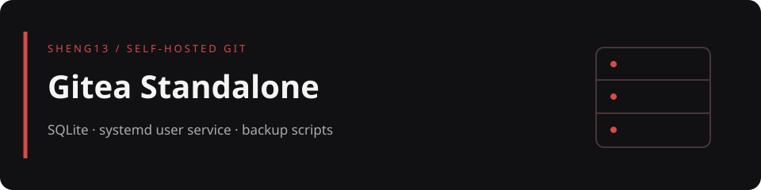

# Gitea Standalone

適合小團隊、課程實驗與內網環境的 Gitea 單機部署範例。使用 SQLite 與 systemd 使用者服務，提供下載初始化、服務管理、建立管理員與打包備份的 Shell 腳本，不需要另外啟動資料庫服務。

> 儲存庫只保存部署腳本、範例設定與說明，不保存資料庫、使用者倉庫、日誌、Token、私鑰或 Gitea 二進位檔。正式資料與教學檔案請分開管理。

[部署前提](#requirements) · [開始使用](#start) · [日常操作](#operations) · [備份](#backup) · [檔案與文件](#map) · [安全提醒](#safety)

<a id="requirements"></a>
## 部署前提

- Linux、Bash、Git，以及可用的 systemd user session；服務管理使用 `systemctl --user`，不是系統級服務。
- 初始化需要 `curl` 與 `openssl`，備份需要 `tar`、`sha256sum`。
- `install.sh` 的預設版本為 `1.27.0`、架構為 `linux-amd64`。這是腳本預設值，不是最新版本宣告；其他架構需先確認對應發行檔。
- 安裝前先閱讀 [install.sh](install.sh) 與 [app.ini.example](app.ini.example)，確認下載來源、版本、監聽位址與資料路徑。

<a id="start"></a>
## 開始使用

以下指令會下載二進位檔、產生設定，並建立與啟動使用者服務。請在專用測試目錄操作，不要覆蓋既有實例。

```bash
git clone https://github.com/sheng13/gitea-standalone.git
cd gitea-standalone
bash install.sh
bash manage.sh start
```

以瀏覽器開啟 `http://127.0.0.1:3000/`。目前範本的 `HTTP_ADDR = 0.0.0.0`，實際會監聽所有介面，**不是只允許本機**；若只做本機實驗，應在首次啟動前審核產生的 `app.ini` 並限制監聽位址。

初次 `start` 會從服務範本寫入 `~/.config/systemd/user/gitea-standalone.service`，再執行 `daemon-reload` 與 `enable`。登出後持續運作或開機啟動，仍取決於主機的使用者服務設定。

### 安裝參數

| 變數 | 預設值 | 作用 |
|---|---|---|
| `GITEA_VERSION` | `1.27.0` | 下載的 Gitea 發行版 |
| `GITEA_ARCH` | `linux-amd64` | 下載檔案的架構名稱 |
| `GITEA_DOMAIN` | `127.0.0.1` | 寫入 `DOMAIN` 與 `ROOT_URL`，不會改變 `HTTP_ADDR` |

腳本只在二進位檔不存在或不可執行時下載，也只在 `app.ini` 不存在時產生設定。修改上述變數再執行安裝，並不等於完成既有實例升級或重新設定。

<a id="operations"></a>
## 日常操作

```bash
bash manage.sh status
bash manage.sh log
bash manage.sh stop
bash manage.sh start
bash manage.sh restart
```

`log` 持續追蹤 journal，按 `Ctrl+C` 離開日誌畫面。

### 建立管理員

範本關閉公開註冊與網頁安裝流程，使用腳本建立管理員：

```bash
bash manage.sh adduser admin admin@example.com
```

請換成自己的帳號與信箱。腳本隱藏密碼輸入，不把密碼直接寫入命令歷史；但後續會以 CLI 參數傳給 Gitea，主機上的高權限程序仍可能看見，因此應在可信主機執行。

<a id="backup"></a>
## 備份與恢復準備

`backup.sh` 打包 `app.ini`、`gitea.db`、`data/`、`repos/`，並產生 `.sha256` 校驗檔，兩者權限設為 `0600`。它不會自行停止服務，也不是完整的自動恢復工具。

建議先安排維護時段停止寫入，再備份：

```bash
bash manage.sh stop
bash backup.sh
bash manage.sh start
```

若備份失敗，先檢查錯誤並確認服務是否需要重新啟動。輸出位於被 Git 忽略的 `backups/gitea-時間戳記.tar.gz` 與相應 `.sha256`；另存到受保護的異機位置，並定期在隔離環境演練恢復。備份包含秘密與使用者資料，不可公開分享。

<a id="map"></a>
## 檔案與文件

| 路徑 | 用途 |
|---|---|
| [install.sh](install.sh) | 下載 Gitea、建立資料目錄並以隨機值產生設定 |
| [manage.sh](manage.sh) | 使用者服務啟停、狀態、日誌與管理員建立 |
| [backup.sh](backup.sh) | 打包資料與 SHA-256 校驗 |
| [app.ini.example](app.ini.example) | SQLite、倉庫位置、HTTP 與註冊限制範本 |
| [gitea.service.example](gitea.service.example) | systemd 使用者服務範本 |
| [docs/README.md](docs/README.md) | 架設、運作原理、帳號管理、其他部署方案與既有截圖索引 |
| [SECURITY.md](SECURITY.md) | 安全回報與敏感資料提醒 |
| `docs/readme-banner.svg` | 首頁設計橫幅，非 Gitea 介面截圖 |

根目錄腳本採 SQLite；文件索引中的其他部署方案不是這組腳本的必要步驟，請勿混用資料目錄與設定。

<a id="safety"></a>
## 安全提醒

- 不要提交真實 `app.ini`、資料庫、Token、私鑰、日誌、備份或使用者倉庫；`.gitignore` 不是加密或備份機制。
- 範本關閉 Gitea 內建 SSH server；不要把 HTTP clone 與 SSH clone 當成已同時設定完成。
- 本機以外的存取需另外審核 HTTPS、反向代理、防火牆與帳號權限。區域網路測試可用 `hostname -I` 查看主機位址，但不要把真實位址與帳號資料貼到公開 Issue。
- 安裝腳本使用 HTTPS 下載，沒有額外的發行檔簽章或雜湊比對步驟。正式使用前請自行核驗發行檔與版本。
- 本次僅檢查部署檔與文件，未安裝 Gitea、修改使用者服務或執行備份；沒有新增服務可用性或恢復成功的宣告。
